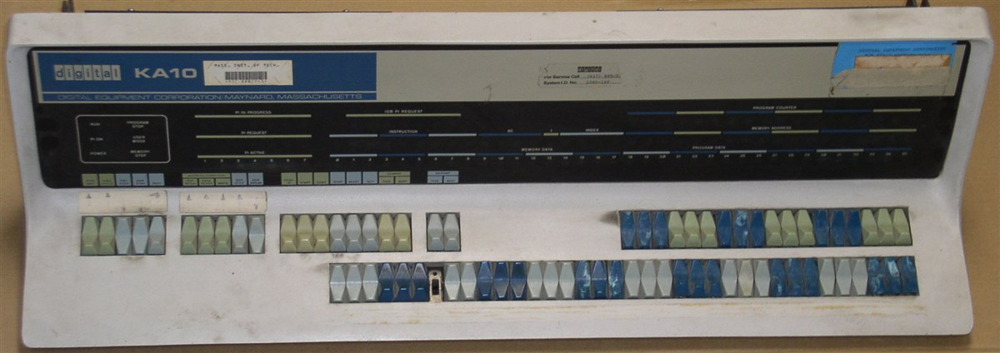

<div align="center">

# ZorkDotNet

[](LICENSE.md)
[](https://github.com/nymankla/ZorkDotNet/actions/workflows/dotnet-desktop.yml)

[](https://github.com/nymankla/ZorkDotNet/releases/latest)
</div>

#### *You are standing in an open field west of a white house.* The Great Underground Empire, with its treasures, grues, and twisty little passages, rebuilt in .NET. One executable, any platform. No pictures. Just words and your imagination.

A .NET port of [Zork](https://en.wikipedia.org/wiki/Zork), the classic interactive fiction game. ZorkDotNet runs on Windows, Linux, and Mac.

<div align="center">


<sub>The front panel of an MIT KA10, the kind of PDP-10 that Zork was written on. Photo: [J. Noel Chiappa](https://commons.wikimedia.org/wiki/File:KA10FrontPanel.jpg), [GFDL 1.2+](https://www.gnu.org/licenses/old-licenses/fdl-1.2.html).</sub>

</div>


## For players

### What this is

This is the **original Zork**: the game written at MIT in 1977 for a PDP-10 mainframe, before Infocom split it into Zork I, II and III. It is one big dungeon with everything in it: the white house, the troll, the thief, the cyclops, the dam, the coal mine, the balloon in the volcano and the robot. It was also known as *Dungeon* ([its history at MIT](https://web.mit.edu/games/src/dungeon/History)).

### How close it is to the original

Very close. This fork rebuilt the game from the original MDL source code, routine by routine:

- **The world matches the original exactly.** Every room, exit, object and word the original game knows is checked automatically against the 1977 data file on every build, and there are no differences left.
- **The puzzles, characters and timers are ported from the original code**: the thief and his hideaway, the cyclops, the dam, the balloon, the robot, the bucket in the well, the lamp and candles burning down, and so on. Each one has tests that play it through.
- **The messages are the original ones**, including the deaths and the jokes.
- **One exception: fighting.** The original's combat code isn't in MIT's archive, so fights with the troll and the thief use this port's own simpler rules.

### Install

1. Download the zip for your computer from the **[latest release](https://github.com/nymankla/ZorkDotNet/releases/latest)**:
   - Windows: `ZorkDotNet-win-x64.zip` (or `win-arm64`)
   - Mac: `ZorkDotNet-osx-arm64.zip` for Apple silicon (M1 and later), `osx-x64` for Intel Macs
   - Linux: `ZorkDotNet-linux-x64.zip` (or `linux-arm64`, or `linux-arm` for 32-bit Raspberry Pi)
2. Unzip it. There is a single file, nothing to install.
3. Run it from a terminal:
   - Windows: double-click `Zork.exe`, or run it in a terminal. If SmartScreen warns you, choose **More info → Run anyway**.
   - Mac and Linux: open a terminal in that folder and run `./zork`. On a Mac, if it is blocked as coming from an unidentified developer, run `xattr -d com.apple.quarantine zork` once first.

If you have the .NET 11 SDK, you can also play from the source: `dotnet run --project ZorkDotNet`.

### The full-screen interface (optional)

The game starts in the original style: a prompt and scrolling text. If you'd rather have a modern screen, start it with `--fancy`:

```
zork --fancy                 (Zork.exe --fancy on Windows)
zork --fancy --theme light   for dark text on a light background
```

You get the room, score and moves at the top, buttons for the common commands (F1 Look, F2 Inventory, F3 Score, F4 Save, F5 Restore, F6 Help, F7 Quit, F8 Theme), the story in a scrolling pane, the commands you've typed in a list beside it, and a box to type in at the bottom.

- **Enter** sends what you typed; **↑/↓** bring back earlier commands.
- **Tab** moves to the command list (pick a command with ↑/↓ and press Enter to put it back in the box) and then to the buttons (pick one with ←/→ and press Enter). This works in every terminal, including VS Code's, which keeps F1, F5 and F8 for itself.
- **PgUp/PgDn** scroll the story; the **Theme** button (or F8) switches between dark and light; **Ctrl+C** leaves.

It needs a terminal window of at least 70×16; if the window is too small, it starts the classic interface instead. Set `NO_COLOR` for a version without colours. `zork --help` lists the options.

### How to play

You explore by typing short commands after the `>` prompt, and the game tells you what happens.

```
> open mailbox
Opening the mailbox reveals a leaflet.
> take leaflet
Taken.
```

- **Move** with directions: `north`, `south`, `east`, `west`, `up`, `down` (or just `n`, `s`, `e`, `w`, `u`, `d`, plus `ne`, `nw`, `se`, `sw`, `in`, `out`).
- **Act** with a verb and an object: `take lamp`, `open door`, `read leaflet`, `turn on lamp`, `put sword in case`, `attack troll with sword`.
- **Useful commands**: `look` (`l`), `inventory` (`i`), `score`, `help`, `info`, `brief`/`superbrief` (shorter room descriptions), `quit`.
- **Saving**: `save` writes `zork.sav` in the current folder and, as in the original, ends the game; start it again and type `restore` to continue.

The goal is to find the treasures and put them in the trophy case in the living room. Carry a light underground: in the dark you are likely to be eaten by a grue.

New to this kind of game? [How to Play Interactive Fiction](https://www.eblong.com/zarf/zweb/dreamhold/help.html) is a short, friendly guide, and the [Zork article on IFWiki](https://www.ifwiki.org/Zork_(game)) has more about the game and its versions.

## About this fork

This repository is a fork of **[Team-Resurgent/ZorkDotNet](https://github.com/Team-Resurgent/ZorkDotNet)**, which created the .NET port.

This fork set out to do two things, and both are done:

- **Fix the bugs** in the port.
- **Close every gap to the original 1977 version**, so that the rooms, objects, puzzles, vocabulary and messages match the MDL source.

All known bugs are fixed and all the gaps are closed: every item in the tracking issue, [issue #1](https://github.com/nymankla/ZorkDotNet/issues/1), is done. The original dungeon data is still checked automatically against the port on every build, so any new difference is caught. The one part that can't be ported line by line is fighting, whose original code isn't in MIT's archive.

### An experiment with Claude AI

This fork is also a test of how well an AI, [Claude](https://claude.com/claude-code), can port an old system from a dead language. The original is written in MDL (also called Muddle), a Lisp dialect from MIT in the 1970s that hardly anyone has run in decades.

The starting point was Team-Resurgent's .NET port, which had bugs and was far from complete: [issue #1](https://github.com/nymankla/ZorkDotNet/issues/1) lists everything that was missing or wrong compared with the original.

It worked very well, and took about one day of work. The method:

1. **Tests against the original first.** I specified tests that compare the port with the 1977 MDL source, and Claude wrote them, together with a reader for the original MDL data file. Every room, exit, object and word in that file is checked against the C# world.
2. **Then Claude iterated.** Claude read the MDL routines, wrote the C# code, wrote tests for each feature and puzzle, and checked that everything passed, over and over until the port was done.
3. **Me in the loop when needed.** Sometimes Claude worked through several features on its own. Other times I reviewed and validated the result between runs before letting it continue.

The tests are what made this work: with the original as the reference and a test for every change, each step could be checked, whoever wrote it.

## Original source

The game originates from the 1977 version of Zork created at MIT by Tim Anderson, Marc Blank, Bruce Daniels, and Dave Lebling. The **1977 source code** is preserved and published by MIT’s Department of Distinctive Collections (DDC):

- **[MITDDC/zork](https://github.com/MITDDC/zork)** Source code for the 1977 version of Zork (MDL, from the [Tapes of Tech Square (ToTS)](https://archivesspace.mit.edu/repositories/2/archival_objects/347748) collection).

This repository is an independent reimplementation in C#/.NET and is not affiliated with MIT or Infocom.
